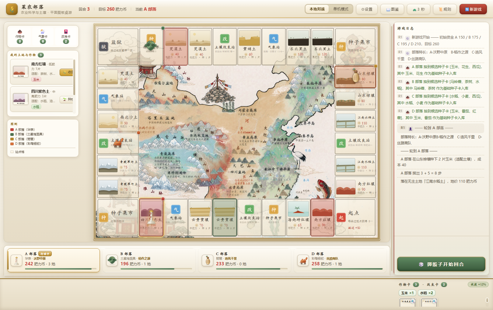
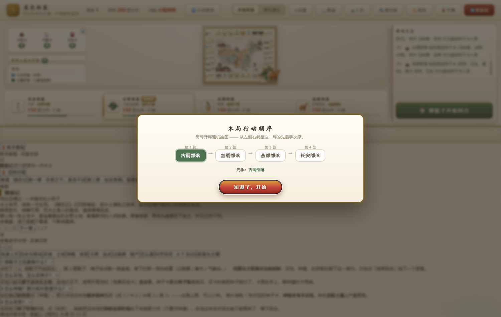

# 菜农部落 · 农耕科学桌游（网页版）

> 一款以**种菜、农业改良、收获售卖**为核心玩法的策略桌面游戏（类大富翁玩法）。
> 玩家扮演不同部落，通过抢占肥沃土地、规划作物种植、收获蔬菜积累财富，
> 在轻松欢乐的农耕博弈中体验策略规划和财富增长的乐趣。

纯静态网页，**零依赖、零构建、无后端**：原生 HTML + CSS + ES Module，
把目录丢到任意静态服务器（或 GitHub Pages）即可游玩。


---

## 快速开始

```bash
# 方式一：自带服务（推荐，带 no-cache 头，避免浏览器缓存旧模块）
python serve.py 8932
# 打开 http://127.0.0.1:8932/index.html

# 方式二：任意静态服务器
python -m http.server 8932
```

> ⚠️ **必须走 HTTP，不能双击 `file://`** —— 游戏用了 ES Module，`file://` 会被浏览器的 CORS 策略拦下。
>
> ⚠️ 改完代码刷新后如果行为没变，是浏览器启发式缓存了 JS 模块。
> 用 `serve.py`（它给每个响应加 `Cache-Control: no-cache`）能彻底避免「新 main.js + 旧 engine.js」的混搭假 bug。

Windows 用户也可以直接双击仓库根目录的 `启动菜农部落.bat`。

---

## 玩法一览

| 项目 | 说明 |
|---|---|
| 赛道 | 32 格环形赛道，串起 4 个部落与若干站点 |
| 土地 | 11 种土壤（黄绵土、东北黑土、江南水稻土、四川紫色土、西北沙土、南方红壤、山东棕壤、荒漠土、云贵黄壤、海南砖红壤、青藏草甸土） |
| 作物 | 10 种（马铃薯、花生、西瓜、红薯、小麦、番茄、黄瓜、水稻、油菜、玉米） |
| 改良卡 | 12 张（有机肥、堆肥、测土配方、蚯蚓、地膜覆盖、滴灌、机械化、沼液、激素、增产、催化剂、沃肥） |
| 初始资金 | 260 币 |
| 部落 | 4 个（各 4 块地 + 4 条赛道起点，能力各异） |

三种常见操作：
- **买地** —— 落在无主地块上，花钱买下这块土地
- **种植** —— 用种子卡在自有土地上种作物，按生育期推进
- **收获售卖** —— 作物成熟后收钱，钱可以继续买地、买种子、买改良卡



### 两种对局模式

顶栏右侧可切换，切换会自动重开一局：

- **本地对战** —— 四个部落都由真人轮流点击操作，适合同桌玩
- **单机模式** —— 开局可选部落，电脑控制其余三个；电脑每执行一步停 3 秒，日志逐条播报

单机模式下真人先手（`G.turn = HUMAN_SEAT`），否则选了非 A 部落时一开局就得干等三个电脑各走完。



---

## 教学属性：4 个「科学性 BUG」

本项目同时是**课程教具**。游戏机制里忠实保留了原版设定的 4 个科学性缺陷，
让学生试玩找茬、科学探究、修改规则后验证效果：

1. 施肥与产量关系不真实（氮磷钾的边际收益被简化掉）
2. 土地「地力」无衰减，长期耕作不影响收成
3. 气象对作物的影响是离散的、随机的，而非连续累积
4. 土地价格与实际区位价值脱钩（地段不分好坏）

> 面向玩家的游戏内规则只讲玩法、不讲缺陷；这 4 条的教学说明保留在
> [`docs/游戏规则.md`](docs/游戏规则.md) 第 19 节、
> [`docs/SPEC.md`](docs/SPEC.md) 第 6 节、
> [`docs/新手教程.md`](docs/新手教程.md) 第八节，以及 `src/aihelper.js` 的问答里。

---

## 目录结构

```
.
├── index.html            唯一入口：页面骨架 + 开篇引导层 + 顶栏 + 棋盘
├── style.css             全部样式
├── intro.css             开篇与玩法介绍引导层样式
├── serve.py              开发/教学用 HTTP 服务（禁用缓存）
├── src/
│   ├── data.js           静态数据：土地/作物/气象/改良卡/赛道/规则
│   ├── motifs.js         部落定义 + 纹样 SVG
│   ├── tribes.js         部落字典（纯数据 + 读写器）
│   ├── engine.js         引擎：所有规则与结算，纯函数，不碰 DOM
│   ├── cardArt.js        SVG 卡面绘制
│   ├── cellPositions.js  赛道 32 格坐标表
│   ├── handbook.js       图鉴弹层
│   ├── bgm.js            背景音乐（与游戏解耦）
│   ├── codex.js          农耕志（成就/图鉴/我的农事）
│   ├── aihelper.js       新手教程「小禾」问答手册
│   ├── intro.js          开篇封面 / 部落展示 / 游戏简介卷轴
│   └── main.js           UI 层：渲染、交互、回合流程
├── assets/               底图、卡面图、纹样、BGM
├── test/                 自动化测试（node 套件 + 无头浏览器页面）
├── tools/                出图/标定用 Python 脚本（非运行时依赖）
├── docs/                 规则、规格、设计文档、截图
├── 参赛材料/             参赛表单、说明文件、海报设计稿
└── 游戏pdf/              课程方案与规则设计 PDF
```

---

## 测试

```bash
# 纯逻辑（node，无需浏览器）
node test/spec.test.js
node test/engine.test.js
node test/track.test.js
node test/track-content.test.js

# 交互回归（需要先起本地服务器，再用无头浏览器打开）
#   test/ui.test.html / guofeng.test.html / human-logic.test.html / iter.test.html
```

---

## 技术要点

- **两层图板叠加**：外圈 32 张印刷赛道卡（`board_full.png`）+ 中心地图（`board_map.png`），
  格子、卡面、卡位牌全部用 **SVG 现画**（宣纸底 + 墨线双框 + 回纹角饰 + 朱砂印章），
  任意缩放都不糊。
- **分层架构**：`tribes.js` 部落字典（只记录「有什么」，无规则）+ `engine.js` 引擎函数（所有判定与结算）。
  一条规则只写一次，四个部落自动遵守。
- **seat ≠ turn**：seat 是「坐在第几号位」（数组下标，永不变），turn 是「行动顺序里的第几位」（每局随机打乱）。
  展示给玩家的东西用 `viewMe()`，回合流程才用当前行动者。
- **回合流程单一状态机**：掷骰 → 走完所有步数 → 落格结算 → 决策（买地/种植/收获/用卡）→ 换手。

---

## 授权

代码与素材仅供教学与竞赛交流使用。素材中的国风地图与卡面为本项目自行绘制/裁切整理。
